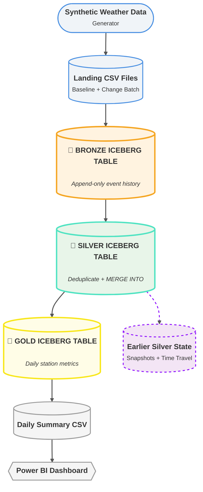

# 🌦️ Weather Ledger: Modern Data Lakehouse Pipeline

**Un pipeline de datos escalable y con garantías ACID, que ingesta, procesa y almacena datos meteorológicos utilizando la Arquitectura Medallón.**

## 📖 Sobre el Proyecto

**Weather Ledger** es un proyecto moderno de ingeniería de datos diseñado para extraer datos meteorológicos en tiempo real, procesarlos y almacenarlos en un formato confiable y consultable.

Construido desde cero para cerrar la brecha entre los requisitos del negocio y la ejecución técnica, este proyecto demuestra las mejores prácticas en la construcción de un **Data Lakehouse**. Utiliza **Apache Iceberg** para resolver los desafíos tradicionales de los data lakes (como la evolución del esquema y las transacciones ACID), mientras emplea **Apache Spark** para el procesamiento distribuido.

Los flujos de datos meteorológicos deben lidiar con algo más que registros limpios y perfectamente ordenados. Una misma observación puede llegar más de una vez, una estación puede corregir una lectura y una observación puede llegar después de su fecha original.

Este proyecto crea un <MARK>**Lakehouse**</MARK> meteorológico de extremo a extremo utilizando <mark>**Apache Iceberg**</mark> para demostrar cómo se pueden manejar esos cambios, al tiempo que se mantiene la precisión de los resultados analíticos y se ponen a disposición para su inspección los estados anteriores de las tablas.

El canal de datos fluye de **Bronce** → **Plata** → **Oro**:

* **Capa de Bronce**: conserva los eventos meteorológicos entrantes, incluyendo las entregas repetidas y las correcciones.

* **Capa de Plata**: mantiene una observación actual para cada estación y cada marca de tiempo de observación.

* **Capa de Oro**: genera métricas meteorológicas diarias para análisis y paneles de control.

📋 <mark>**Nota sobre el conjunto de datos**</mark>: todas las mediciones meteorológicas son datos sintéticos generados localmente para este proyecto. No son lecturas en vivo de estaciones meteorológicas reales.

__________________________________________________________________________________________________________________________________________________________________________________________________________________
## 🏗️ Arquitectura

El pipeline sigue la **Arquitectura de Medalla** (Bronce, Plata, Oro), implementando actualmente la ingesta fundamental de la capa Bronce.

___________________________________________________________________________________________________________________________________________________________________________________________________________________

## 💡El problema que resuelve

Imagina que una estación meteorológica envía una observación y, más tarde, llega una versión corregida. Otra observación se envía dos veces. Mientras tanto, una lectura de un día anterior llega con retraso.

Un proceso confiable debería poder:

| Desafío | Lo que el proceso debe hacer |
|---------|------------------------------|
| Envíos duplicados | Conservar los eventos recibidos en **Bronze** y mantener una sola fila actual en **Silver** |
| Observaciones corregidas | Actualizar la observación actual cuando llegue una revisión más reciente |
| Datos que llegan tarde | Agregar la observación a la estación y fecha históricas correctas y actualizar las métricas diarias |
| Inspección histórica | Consultar una instantánea anterior de Iceberg para ver el estado de la tabla antes de un cambio |
| Análisis confiables | Recalcular los resúmenes diarios a partir del estado actual en Silver |

📌 El objetivo no es simplemente mover un archivo CSV a través de tres carpetas. Es demostrar cómo un formato de tabla como Apache Iceberg puede respaldar un flujo de trabajo de <mark>**lakehouse**</mark> en el que los datos cambian con el tiempo.

___________________________________________________________________________________________________________________________________________________________________________________________________________________

##  Características de Apache Iceberg

Este proyecto se centra en un conjunto práctico de capacidades de Iceberg y muestra cómo se integran en un flujo de datos.

| Característica | Cómo se utiliza en este proyecto |
|----------------|----------------------------------|
| Tablas y catálogo de Iceberg | Almacenar Bronze, Silver y Gold como tablas de Iceberg a través del catálogo de Iceberg de Spark |
| Añadir confirmaciones | Agregar eventos entrantes a la tabla Bronze sin perder las entregas repetidas |
| MERGE INTO / upserts | Actualiza las observaciones corregidas e inserta las observaciones recién llegadas en Silver |
| Historial de instantáneas | Revisa las instantáneas de tablas confirmadas a través de las tablas de metadatos de Iceberg |
| Tablas de metadatos | Consulta .snapshots para revisar los ID de las instantáneas, las operaciones y el historial de confirmaciones |
| Viaje en el tiempo | Consulta una instantánea guardada de Silver para recuperar el valor anterior a la corrección |
| Actualización de Gold | Vuelve a calcular los análisis diarios a partir de la tabla Silver actualizada y confirma el estado actualizado de Gold |

___________________________________________________________________________________________________________________________________________________________________________________________________________________
## 🧰 Pila tecnológica

| Tecnología | Función |
|------------|---------|
| Apache Iceberg 1.9.2 | Formato de tabla, confirmaciones, historial de instantáneas, consultas de metadatos y **viaje en el tiempo** | 
| Apache Spark 3.5.1 | Motor de ejecución distribuida |
| PySpark | Ingesta de datos, validación, deduplicación, fusiones y agregación |
| Biblioteca estándar de Python | Generar entrada CSV sintética determinista |
| Spark SQL | Inspeccionar las tablas y verificar el comportamiento del flujo de trabajo |
| Docker / Docker Compose | Ejecutar el entorno local de Spark |
| Power BI Desktop | Visualizar el resumen Gold exportado |

___________________________________________________________________________________________________________________________________________________________________________________________________________________

## 🗃️ Tablas Iceberg

| Capa | Tabla | Responsabilidad |
|------|-------|-----------------|
| 🟤 Bronce | <mark>local.weather_demo.bronze_events</mark> | Historial de eventos meteorológicos recibidos, solo de adición |
| ⚪ Plata | <mark>local.weather_demo.silver_observations</mark> | Una observación actual por clave (**station_id, observed_at**) |
| 🟡 Oro | <mark>local.weather_demo.gold_daily_summary</mark> | Un registro analítico por estación y fecha del calendario |

* **Ubicación del almacén dentro del entorno de Spark:** /opt/iceberg/warehouse/weatherledger_project

___________________________________________________________________________________________________________________________________________________________________________________________________________________
## 📂 Estructura del Proyecto

___________________________________________________________________________________________________________________________________________________________________________________________________________________
## 🚀 Cómo Ejecutarlo Localmente

<mark>**Importante:**</mark> este repositorio está diseñado para la configuración local de Docker/Spark incluida. Inicia los contenedores y verifica las rutas montadas y el archivo JAR del tiempo de ejecución de Iceberg utilizando la infraestructura y los archivos de referencia de comandos proporcionados antes de enviar las solicitudes.

1. **Requisitos Previos**

- Docker Desktop con Docker Compose.

- Los archivos de infraestructura del proyecto y los contenedores de Spark necesarios en ejecución

- Apache Spark 3.5.1

- El tiempo de ejecución de Apache Iceberg 1.9.2 disponible dentro de los contenedores de Spark

- Los directorios montados de la aplicación y de datos utilizados por los comandos incluidos

La ruta configurada del archivo JAR del tiempo de ejecución de Iceberg en el contenedor es:

            /opt/iceberg-jars/iceberg-spark-runtime-3.5_2.12-1.9.2.jar

Los comandos de Spark configuran las extensiones de Iceberg para Spark SQL, un catálogo de Spark respaldado por Hadoop llamado «local», el almacén del proyecto y la zona horaria de la sesión en UTC. Mantenga estos ajustes consistentes en las tres aplicaciones.

**2. Configuración**

Clona el repositorio y navega a la carpeta raíz:

bash:

    git clone https://github.com/AllGoHer/weather_ledger.git
    cd weather_ledger

**3. Iniciar el Clúster de Spark**

Construye e inicia los contenedores Docker (Spark Master y Worker):

bash:

        docker compose up -d --build

Verifica que el clúster esté funcionando visitando:

- Interfaz de Spark Master: http://localhost:8080

- Interfaz de Spark Worker: http://localhost:8081

**4. Orden de ejecución recomendado**

1. Inicia la infraestructura utilizando la configuración de Docker/Spark proporcionada.

2. Genera los archivos de entrada sintéticos con [generate_demo_data.py](https://github.com/AllGoHer/Weather-Ledger/blob/main/apps/weatherledger_project/generate_demo_data.py).

3. Carga el lote de referencia ejecutando [bronze_ingest.py](https://github.com/AllGoHer/Weather-Ledger/blob/main/apps/weatherledger_project/bronze_ingest.py).

4. Crea el estado actual inicial ejecutando [silver_upsert.py](https://github.com/AllGoHer/Weather-Ledger/blob/main/apps/weatherledger_project/silver_upsert.py).

5. Crea el resumen diario inicial ejecutando [gold_analytics.py](https://github.com/AllGoHer/Weather-Ledger/blob/main/apps/weatherledger_project/gold_analytics.py).

6. Usa [inspection_queries.sql](https://github.com/AllGoHer/Weather-Ledger/blob/main/apps/weatherledger_project/SQL/inspection_queries.sql) para revisar la singularidad de Bronce y Plata, así como el resumen actual. Guarda el ID de la instantánea actual de Plata antes de procesar los cambios.

7. Incorpora el lote de cambios ejecutando [bronze_ingest.py](https://github.com/AllGoHer/Weather-Ledger/blob/main/apps/weatherledger_project/bronze_ingest.py) nuevamente.

8. Aplica la corrección y el evento atrasado ejecutando [silver_upsert.py](https://github.com/AllGoHer/Weather-Ledger/blob/main/apps/weatherledger_project/silver_upsert.py) nuevamente; revisa la resolución de entregas duplicadas.

9. Consulte la instantánea de Silver guardada antes del cambio utilizando el viaje en el tiempo de Iceberg.

10. Actualice la tabla Gold ejecutando [gold_analytics.py](https://github.com/AllGoHer/Weather-Ledger/blob/main/apps/weatherledger_project/gold_analytics.py) nuevamente y compare las métricas diarias afectadas.

Utilice la referencia de comandos proporcionada para conocer las invocaciones exactas de spark-submit en PowerShell y las rutas de los archivos montados. Ejecutar [bronze_ingest.py](https://github.com/AllGoHer/Weather-Ledger/blob/main/apps/weatherledger_project/bronze_ingest.py), [silver_upsert.py](https://github.com/AllGoHer/Weather-Ledger/blob/main/apps/weatherledger_project/silver_upsert.py) y [gold_analytics.py](https://github.com/AllGoHer/Weather-Ledger/blob/main/apps/weatherledger_project/gold_analytics.py) fuera de orden no reproducirá los puntos de control previstos.

**5. Cargar el archivo Jar**

Powershell:

            Invoke-WebRequest `
              -Uri "https://repo1.maven.org/maven2/org/apache/iceberg/iceberg-spark-runtime-3.5_2.12/1.9.2/iceberg-spark-runtime-3.5_2.12-1.9.2.jar" `
              -OutFile ".\jars\iceberg-spark-runtime-3.5_2.12-1.9.2.jar"

**6. Ejecutar la aplicación**

Powershell:

            cd apps
            
            docker exec iceberg-spark-master /opt/spark/bin/spark-submit `
              --master spark://spark-master:7077 `
              --jars /opt/iceberg-jars/iceberg-spark-runtime-3.5_2.12-1.9.2.jar `
              --conf spark.sql.extensions=org.apache.iceberg.spark.extensions.IcebergSparkSessionExtensions `
              --conf spark.sql.catalog.local=org.apache.iceberg.spark.SparkCatalog `
              --conf spark.sql.catalog.local.type=hadoop `
              --conf spark.sql.catalog.local.warehouse=/opt/iceberg/warehouse/weatherledger_project `
              --conf spark.sql.defaultCatalog=local `
              --conf spark.sql.session.timeZone=UTC `
              /opt/spark-apps/weatherledger_project/<<app_name>>.py

**7. Abrir el trabajador de Spark**

en otra terminal y en la raíz del proyecto.

Powershell:

            docker exec -it iceberg-spark-worker bash

**8. Abrir sesión Spark**

Para hacer consultas y verificaciones.

Powershell:

            /opt/spark/bin/pyspark \
              --master spark://spark-master:7077 \
              --jars /opt/iceberg-jars/iceberg-spark-runtime-3.5_2.12-1.9.2.jar \
              --conf spark.sql.extensions=org.apache.iceberg.spark.extensions.IcebergSparkSessionExtensions \
              --conf spark.sql.catalog.local=org.apache.iceberg.spark.SparkCatalog \
              --conf spark.sql.catalog.local.type=hadoop \
              --conf spark.sql.catalog.local.warehouse=/opt/iceberg/warehouse/weatherledger_project

___________________________________________________________________________________________________________________________________________________________________________________________________________________

## ✅ Resultados de la validación

Se verificaron los siguientes resultados en la ejecución local completada utilizando datos sintéticos para 2024.

**Recuento de filas**

| Punto de control | Filas esperadas / observadas |
|------------------|------------------------------|
| Eventos de referencia (Bronce) | 70,272 |
| Observaciones actuales (Plata) después de la referencia | 70,272 |
| Resumen diario (Oro) después de la referencia | 2,928 |
| Bronce después del lote de cambios de cuatro eventos | 70,276 |
| Plata después de aplicar el lote de cambios | 70,273 |
| Oro después de la actualización | 2,928 |

¿Por qué Plata termina con 70,273 filas en lugar de 70,276? Bronce conserva cada evento entrante. Plata mantiene la fila actual por clave de negocio: la corrección actualiza una clave existente, las entregas duplicadas se agrupan en una sola clave actual y la observación tardía introduce una nueva clave.

El nivel Oro se mantiene en 2,928 filas porque tiene una fila para cada una de las 8 estaciones × 366 fechas del calendario en el año bisiesto 2024. La lectura que llega tarde modifica un agregado existente de estación/día en lugar de crear uno nuevo de estación/día.

**Escenarios comprobados en la ejecución**

| Escenario | Antes | Después | Lo que demuestra |
|-----------|-------|---------|------------------|
| Corrección ST-001 | 26.52 °C, revisión 1 | 29.02 °C, revisión 2 | Silver actualiza el registro actual cuando llega una revisión más reciente |
| Entregas duplicadas ST-002 | Registro de referencia más dos entregas adicionales en Bronze | Una fila actual en Silver para esa clave | Bronze conserva el historial de entregas; Silver resuelve los duplicados |
| ST-003: observación tardía | 24 observaciones por estación/día | 25 observaciones | Un evento tardío se incorpora al agregado diario histórico correcto |
| Viaje en el tiempo de Silver | Valor corregido actual | Una instantánea anterior devuelve 26.52 °C | Se puede consultar un estado anterior de la tabla que ya se haya confirmado |

✅ Estos resultados validan los escenarios demostrados. No constituyen una afirmación de que el proyecto esté implementado como un servicio de producción ni conectado a un proveedor de información meteorológica en tiempo real.

___________________________________________________________________________________________________________________________________________________________________________________________________________________
### 📈 Salida de Power BI

La aplicación Gold exporta un archivo CSV para un informe de Power BI. La exportación corresponde a una capa de consumo; la tabla analítica de Gold en sí misma sigue siendo una tabla **Iceberg**.

Ruta de exportación en el contenedor:

            /opt/spark-data/weatherledger_project/powerbi/daily_weather_summary.csv

**Ideas para el tablero:**

* **Tarjetas de KPI:** temperatura promedio, precipitación total, velocidad máxima del viento y número de estaciones.

* **Gráfico de líneas:** temperatura promedio diaria a lo largo del tiempo.
  
* **Gráfico de columnas:** precipitación total por estación.
  
* **Gráfico de tendencias:** temperatura a lo largo del tiempo con una leyenda de estaciones o un filtro.
  
* **Matriz:** estación, fecha, número de observaciones, temperatura, humedad, precipitación y velocidad máxima del viento

* **Filtros:** rango de fechas y estación.
  
Etiqueta el tablero como **datos sintéticos**.

___________________________________________________________________________________________________________________________________________________________________________________________________________________

### 🔍 Qué explorar en las consultas SQL

El archivo de inspección SQL incluido te ayuda a verificar el proceso, en lugar de limitarte a confiar en los registros de la aplicación. Úsalo para:

* Contar los eventos Bronce por lote.
  
* Inspeccionar las entregas duplicadas entrantes.

* Confirmar la unicidad de las claves de negocio Plata.

* Comparar los valores anteriores y actuales de la observación corregida.

* Verificar la observación de la estación que llegó tarde.

* Inspeccionar los metadatos de .snapshots y guardar un ID de instantánea real.

* Consultar la instantánea **Silver** anterior con la función **time travel**.

* Comparar los resúmenes diarios **Gold** afectados.

📋 **Nota:** Los ID de instantánea se generan cuando Iceberg confirma los cambios. No des por sentado que un ID de instantánea que aparece en otra ejecución existirá en tus propias tablas.

___________________________________________________________________________________________________________________________________________________________________________________________________________________

## ⚠️ Notas sobre el alcance y el diseño

* Los registros meteorológicos son sintéticos y se generan localmente.

* La configuración utiliza un catálogo de Iceberg local respaldado por Hadoop; no se trata de una implementación en la nube.

* Bronze, Silver y Gold son todas tablas de Iceberg en esta implementación.

* La deduplicación y las reglas de claves de negocio forman parte de la lógica de la aplicación; Iceberg no impone una restricción de clave primaria.

* La ruta de actualización que se muestra utiliza trabajos por lotes, no Kafka ni ingestión en tiempo real.

* Este es un proyecto específico de la cartera, no una afirmación de orquestación de nivel de producción ni una plataforma de producción totalmente administrada.

___________________________________________________________________________________________________________________________________________________________________________________________________________________

## 🚀 Desarrollo del proyecto paso a paso

1. Creamos la carpeta del proyecto

Powershell:

        mkdir Weather Ledger

Powershell:

        Cd Weather_Ledger

2. Descarga [docker-compose.yml](https://github.com/AllGoHer/Weather-Ledger/blob/main/docker-compose.yml) a tu carpeta Weather_Ledger.

3. levantamos la infraestructura.
 
 PowerShell:

            docker compose up -d

Verificamos en docker desktop

4.	Ahora, en powershell, ejecutamos el siguiente comando de descarga del archivo.

Powershell:

            Invoke-WebRequest ` -Uri "https://repo1.maven.org/maven2/org/apache/iceberg/iceberg-spark-runtime-3.5_2.12/1.9.2/iceberg-spark-runtime-3.5_2.12-1.9.2.jar" `
                           -OutFile ".\jars\iceberg-spark-runtime-3.5_2.12-1.9.2.jar"
            

5.	 descargamos también generador de datos del repositorio, pero lo descargamos en la subcarpeta de apps, y luego ejecutamos.

PowerShell:

            cd apps
            python generate_demo_data.py

seguidamente, te preguntara que año quieres ejecutar, en este caso, 2024.

Para ordenar mejor los datos, cortamos los datos o carpeta generada llamada weatherledger_project y lo pegamos en la carpeta data.

6. Creamos la capa bronce en VSCode.

A la capa bronce lo nombramos bronze_ingest.py

Código:

            import csv
            import os
            from pyspark.sql import SparkSession
            from pyspark.sql.functions import to_timestamp
            
            NAMESPACE = "local.weather_demo"
            TABLE = f"{NAMESPACE}.bronze_events"
            
            DATA_DIR = "/opt/spark-data/weatherledger_project/landing"
            BASELINE = os.path.join(DATA_DIR, "weather_baseline.csv")
            CHANGES = os.path.join(DATA_DIR, "weather_changes.csv")
            
            def get_source_batch_id(path):
            
                if not os.path.isfile(path):
                    raise FileNotFoundError(
                        f"Input file not found: {path}. Run generate_demo_data.py first."
                    )
            
                with open(path, "r", newline="", encoding="utf-8") as file:
                    reader = csv.DictReader(file)
            
                    first_row = next(reader, None)
            
                    if first_row is None:
                        raise ValueError(f"Input file has no data rows: {path}")
            
                    batch_id = (first_row.get("source_batch_id") or "").strip()
            
                    if not batch_id:
                        raise ValueError(
                            f"Missing source_batch_id in input file: {path}"
                        )
            
                return batch_id
            
            # Discover batch IDs from the actual input files.
            
            baseline_batch_id = get_source_batch_id(BASELINE)
            changes_batch_id = get_source_batch_id(CHANGES)
            
            spark = (
                SparkSession.builder
                .appName("WeatherLedger-Bronze")
                .getOrCreate()
            )
            spark.sparkContext.setLogLevel("ERROR")
            
            spark.sql(f"CREATE NAMESPACE IF NOT EXISTS {NAMESPACE}")
            
            # Find the source batches already represented in Bronze.
            loaded = set()
            
            if spark.catalog.tableExists(TABLE):
                loaded = {
                    row.source_batch_id
                    for row in (
                        spark.table(TABLE)
                        .select("source_batch_id")
                        .distinct()
                        .collect()
                    )
                }
            
            # Load the baseline first, then the changes batch.
            if baseline_batch_id not in loaded:
                path = BASELINE
            elif changes_batch_id not in loaded:
                path = CHANGES
            else:
                print(
                    "Both input batches are already in Bronze; no changes made."
                )
                spark.stop()
                raise SystemExit(0)
            
            # Read the selected CSV into a Spark DataFrame.
            events = (
                spark.read
                .option("header", True)
                .option("inferSchema", True)
                .csv(path)
                .withColumn("observed_at", to_timestamp("observed_at"))
                .withColumn("ingested_at", to_timestamp("ingested_at"))
            )
            
            batch_id = events.select("source_batch_id").first()[0]
            
            # Create the table on the first load; append subsequent batches.
            if not spark.catalog.tableExists(TABLE):
                events.writeTo(TABLE).using("iceberg").create()
            else:
                events.writeTo(TABLE).append()
            
            print(f"Loaded {batch_id}: {events.count():,} events")
            print(f"Bronze total: {spark.table(TABLE).count():,}")
            
            spark.stop()

7.	 ejecutamos en la terminal la capa bronce.

Código:

        docker exec iceberg-spark-master /opt/spark/bin/spark-submit `
          --master spark://spark-master:7077 `
          --jars /opt/iceberg-jars/iceberg-spark-runtime-3.5_2.12-1.9.2.jar `
          --conf spark.sql.extensions=org.apache.iceberg.spark.extensions.IcebergSparkSessionExtensions `
          --conf spark.sql.catalog.local=org.apache.iceberg.spark.SparkCatalog `
          --conf spark.sql.catalog.local.type=hadoop `
          --conf spark.sql.catalog.local.warehouse=/opt/iceberg/warehouse/weatherledger_project `
          --conf spark.sql.defaultCatalog=local `
          --conf spark.sql.session.timeZone=UTC `
          /opt/spark-apps/weatherledger_project/bronze_ingest.py

8.	Inspección de datos.

Primero abrimos el trabajador en powershell.

Powershell:

            docker exec -it iceberg-spark-worker bash

Ahora, abrimos una sesión Spark

Código:

        /opt/spark/bin/pyspark \
          --master spark://spark-master:7077 \
          --jars /opt/iceberg-jars/iceberg-spark-runtime-3.5_2.12-1.9.2.jar \
          --conf spark.sql.extensions=org.apache.iceberg.spark.extensions.IcebergSparkSessionExtensions \
          --conf spark.sql.catalog.local=org.apache.iceberg.spark.SparkCatalog \
          --conf spark.sql.catalog.local.type=hadoop \
          --conf spark.sql.catalog.local.warehouse=/opt/iceberg/warehouse/weatherledger_project

Luego, verificamos los eventos de la capa bronce.

Código:

        spark.sql("""
        select * from local.weather_demo.bronze_events
        """).show()

Esto muestra las primeras 20 filas de las 70,272 filas ingestadas.

Por último, debemos cerrar la sesión.

Código:

        exit();

___________________________________________________________________________________________________________________________________________________________________________________________________________________

### SILVER LAYER

Ahora, creamos el archivo silver llamado silver_upsert.py

Código:

        from pyspark.sql import SparkSession, Window
        from pyspark.sql.functions import col, row_number
        
        BRONZE = "local.weather_demo.bronze_events"
        SILVER = "local.weather_demo.silver_observations"
        spark = SparkSession.builder.appName("WeatherLedger-Silver").getOrCreate()
        spark.sparkContext.setLogLevel("ERROR")
        
        latest = Window.partitionBy("station_id", "observed_at").orderBy(
            col("revision").desc(), col("ingested_at").desc(), col("event_id").desc())
        updates = (spark.table(BRONZE)
            .filter(col("temperature_c").between(-80, 60) &
                    col("humidity_pct").between(0, 100) &
                    (col("precipitation_mm") >= 0) & col("wind_speed_kmh").between(0, 400))
            .withColumn("rn", row_number().over(latest)).filter(col("rn") == 1).drop("rn"))
        updates.createOrReplaceTempView("updates")
        
        if not spark.catalog.tableExists(SILVER):
            updates.writeTo(SILVER).using("iceberg").create()
        else:
            spark.sql(f"""
                MERGE INTO {SILVER} t USING updates s
                ON t.station_id = s.station_id AND t.observed_at = s.observed_at
                WHEN MATCHED AND (s.revision > t.revision OR
                     (s.revision = t.revision AND s.ingested_at > t.ingested_at))
                THEN UPDATE SET t.event_id = s.event_id, t.ingested_at = s.ingested_at,
                     t.temperature_c = s.temperature_c, t.humidity_pct = s.humidity_pct,
                     t.precipitation_mm = s.precipitation_mm, t.wind_speed_kmh = s.wind_speed_kmh,
                     t.revision = s.revision, t.source_batch_id = s.source_batch_id
                WHEN NOT MATCHED THEN INSERT *
            """)
        
        print(f"Silver current observations: {spark.table(SILVER).count():,}")
        spark.stop()

luego, ejecutamos la capa silver en la raíz del proyecto.

Código:

        docker exec iceberg-spark-master /opt/spark/bin/spark-submit `
          --master spark://spark-master:7077 `
          --jars /opt/iceberg-jars/iceberg-spark-runtime-3.5_2.12-1.9.2.jar `
          --conf spark.sql.extensions=org.apache.iceberg.spark.extensions.IcebergSparkSessionExtensions `
          --conf spark.sql.catalog.local=org.apache.iceberg.spark.SparkCatalog `
          --conf spark.sql.catalog.local.type=hadoop `
          --conf spark.sql.catalog.local.warehouse=/opt/iceberg/warehouse/weatherledger_project `
          --conf spark.sql.defaultCatalog=local `
          --conf spark.sql.session.timeZone=UTC `
          /opt/spark-apps/weatherledger_project/silver_upsert.py

Nuevamente, abrimos el trabajador de spark.

Código:

        docker exec -it iceberg-spark-worker bash

luego, abrimos sesión en pyspark.

Código:

        /opt/spark/bin/pyspark \
          --master spark://spark-master:7077 \
          --jars /opt/iceberg-jars/iceberg-spark-runtime-3.5_2.12-1.9.2.jar \
          --conf spark.sql.extensions=org.apache.iceberg.spark.extensions.IcebergSparkSessionExtensions \
          --conf spark.sql.catalog.local=org.apache.iceberg.spark.SparkCatalog \
          --conf spark.sql.catalog.local.type=hadoop \
          --conf spark.sql.catalog.local.warehouse=/opt/iceberg/warehouse/weatherledger_project
        

Verificamos la creación de la capa silver.

Código:

        spark.sql("""
        SELECT *
        FROM local.weather_demo.silver_observations
        """).show()

___________________________________________________________________________________________________________________________________________________________________________________________________________________
### GOLD LAYER

Creamos la capa de oro.

Código:

            import csv
            import os
            from pyspark.sql import SparkSession
            from pyspark.sql.functions import avg, count, max, round, sum, to_date
            
            SILVER = "local.weather_demo.silver_observations"
            GOLD = "local.weather_demo.gold_daily_summary"
            OUTPUT = "/opt/spark-data/weatherledger_project/powerbi/daily_weather_summary.csv"
            spark = SparkSession.builder.appName("WeatherLedger-Gold").getOrCreate()
            spark.sparkContext.setLogLevel("ERROR")
            
            daily = (spark.table(SILVER).withColumn("observation_date", to_date("observed_at"))
                .groupBy("station_id", "observation_date")
                .agg(count("event_id").alias("observation_count"),
                     round(avg("temperature_c"), 2).alias("avg_temperature_c"),
                     round(avg("humidity_pct"), 2).alias("avg_humidity_pct"),
                     round(sum("precipitation_mm"), 2).alias("total_precipitation_mm"),
                     round(max("wind_speed_kmh"), 2).alias("max_wind_speed_kmh")))
            daily.createOrReplaceTempView("daily_updates")
            
            if not spark.catalog.tableExists(GOLD):
                daily.writeTo(GOLD).using("iceberg").create()
            else:
                spark.sql(f"""
                    MERGE INTO {GOLD} t USING daily_updates s
                    ON t.station_id = s.station_id AND t.observation_date = s.observation_date
                    WHEN MATCHED AND (t.observation_count <> s.observation_count OR
                         t.avg_temperature_c <> s.avg_temperature_c OR
                         t.avg_humidity_pct <> s.avg_humidity_pct OR
                         t.total_precipitation_mm <> s.total_precipitation_mm OR
                         t.max_wind_speed_kmh <> s.max_wind_speed_kmh)
                    THEN UPDATE SET t.observation_count = s.observation_count,
                         t.avg_temperature_c = s.avg_temperature_c,
                         t.avg_humidity_pct = s.avg_humidity_pct,
                         t.total_precipitation_mm = s.total_precipitation_mm,
                         t.max_wind_speed_kmh = s.max_wind_speed_kmh
                    WHEN NOT MATCHED THEN INSERT *
                """)
            
            os.makedirs(os.path.dirname(OUTPUT), exist_ok=True)
            rows = spark.table(GOLD).orderBy("observation_date", "station_id").collect()
            with open(OUTPUT, "w", newline="", encoding="utf-8") as file:
                writer = csv.DictWriter(file, fieldnames=list(rows[0].asDict().keys()))
                writer.writeheader()
                writer.writerows(row.asDict() for row in rows)
            
            print(f"Gold rows: {len(rows):,}; Power BI file: {OUTPUT}")
            spark.stop()

ahora, ejecutamos la capa de oro.

Código:

        docker exec iceberg-spark-master /opt/spark/bin/spark-submit `
          --master spark://spark-master:7077 `
          --jars /opt/iceberg-jars/iceberg-spark-runtime-3.5_2.12-1.9.2.jar `
          --conf spark.sql.extensions=org.apache.iceberg.spark.extensions.IcebergSparkSessionExtensions `
          --conf spark.sql.catalog.local=org.apache.iceberg.spark.SparkCatalog `
          --conf spark.sql.catalog.local.type=hadoop `
          --conf spark.sql.catalog.local.warehouse=/opt/iceberg/warehouse/weatherledger_project `
          --conf spark.sql.defaultCatalog=local `
          --conf spark.sql.session.timeZone=UTC `
          /opt/spark-apps/weatherledger_project/gold_analytics.py

Verificamos que se haya creado el archivo para Power BI

Nuevamente, abrimos el trabajador de spark.

Código:

        docker exec -it iceberg-spark-worker bash

luego, abrimos sesión en pyspark.

Código:

        /opt/spark/bin/pyspark \
          --master spark://spark-master:7077 \
          --jars /opt/iceberg-jars/iceberg-spark-runtime-3.5_2.12-1.9.2.jar \
          --conf spark.sql.extensions=org.apache.iceberg.spark.extensions.IcebergSparkSessionExtensions \
          --conf spark.sql.catalog.local=org.apache.iceberg.spark.SparkCatalog \
          --conf spark.sql.catalog.local.type=hadoop \
          --conf spark.sql.catalog.local.warehouse=/opt/iceberg/warehouse/weatherledger_project

Y luego salimos.

Código:
 
         exit();

ahora, hacemos una verificación de los eventos de la capa bronce.

Código:

        spark.sql("""
             SELECT
                 source_batch_id,
                 COUNT(*) AS received_events
             FROM local.weather_demo.bronze_events
             GROUP BY source_batch_id
         """).show(truncate=False)

Código:

        spark.sql("""
            SELECT
               station_id,
               observed_at,
               temperature_c,
               revision,
               event_id
            FROM local.weather_demo.bronze_events
            WHERE station_id = 'ST-001'
            AND observed_at = TIMESTAMP '2024-06-15 12:00:00'
         """).show(truncate=False)

Código:

        spark.sql("""
            SELECT
                committed_at,
                snapshot_id,
                operation
            FROM local.weather_demo.silver_observations.snapshots
            ORDER BY committed_at DESC
         """).show(truncate=False)

Código:

        spark.sql("""
            SELECT
                COUNT(*) AS duplicate_current_keys
            FROM (
                SELECT
                    station_id,
                    observed_at
                FROM local.weather_demo.silver_observations
                GROUP BY station_id, observed_at
                HAVING COUNT(*) > 1
             ) duplicates
         """).show(truncate=False)

Ahora, vamos a ejecutar nuevamente la capa de bronce para ver la actualización de eventos y así confirmara que todo está andando bien.

Código:

        docker exec iceberg-spark-master /opt/spark/bin/spark-submit `
          --master spark://spark-master:7077 `
          --jars /opt/iceberg-jars/iceberg-spark-runtime-3.5_2.12-1.9.2.jar `
          --conf spark.sql.extensions=org.apache.iceberg.spark.extensions.IcebergSparkSessionExtensions `
          --conf spark.sql.catalog.local=org.apache.iceberg.spark.SparkCatalog `
          --conf spark.sql.catalog.local.type=hadoop `
          --conf spark.sql.catalog.local.warehouse=/opt/iceberg/warehouse/weatherledger_project `
          --conf spark.sql.defaultCatalog=local `
          --conf spark.sql.session.timeZone=UTC `
          /opt/spark-apps/weatherledger_project/bronze_ingest.py

Ahora, podemos ver que hay 70,276 eventos, ósea 4 mas que la vez anterior.

Con eso podemos garantizar que código anda bien.

Luego, hacemos lo mismo con silver.

Código:

        docker exec iceberg-spark-master /opt/spark/bin/spark-submit `
          --master spark://spark-master:7077 `
          --jars /opt/iceberg-jars/iceberg-spark-runtime-3.5_2.12-1.9.2.jar `
          --conf spark.sql.extensions=org.apache.iceberg.spark.extensions.IcebergSparkSessionExtensions `
          --conf spark.sql.catalog.local=org.apache.iceberg.spark.SparkCatalog `
          --conf spark.sql.catalog.local.type=hadoop `
          --conf spark.sql.catalog.local.warehouse=/opt/iceberg/warehouse/weatherledger_project `
          --conf spark.sql.defaultCatalog=local `
          --conf spark.sql.session.timeZone=UTC `
          /opt/spark-apps/weatherledger_project/silver_upsert.py

Esto demuestra que se agregó un evento.

Y así mismo, también ejecutamos la capa gold.

Código:

        docker exec iceberg-spark-master /opt/spark/bin/spark-submit `
          --master spark://spark-master:7077 `
          --jars /opt/iceberg-jars/iceberg-spark-runtime-3.5_2.12-1.9.2.jar `
          --conf spark.sql.extensions=org.apache.iceberg.spark.extensions.IcebergSparkSessionExtensions `
          --conf spark.sql.catalog.local=org.apache.iceberg.spark.SparkCatalog `
          --conf spark.sql.catalog.local.type=hadoop `
          --conf spark.sql.catalog.local.warehouse=/opt/iceberg/warehouse/weatherledger_project `
          --conf spark.sql.defaultCatalog=local `
          --conf spark.sql.session.timeZone=UTC `
          /opt/spark-apps/weatherledger_project/gold_analytics.py

Bueno, en la capa gold no varía porque los registros se hacen por días. 

Ahora, volvemos abrir la sesión de spark.

Código:

        /opt/spark/bin/pyspark \
          --master spark://spark-master:7077 \
          --jars /opt/iceberg-jars/iceberg-spark-runtime-3.5_2.12-1.9.2.jar \
          --conf spark.sql.extensions=org.apache.iceberg.spark.extensions.IcebergSparkSessionExtensions \
          --conf spark.sql.catalog.local=org.apache.iceberg.spark.SparkCatalog \
          --conf spark.sql.catalog.local.type=hadoop \
          --conf spark.sql.catalog.local.warehouse=/opt/iceberg/warehouse/weatherledger_project

Código:

        spark.sql("""
            SELECT
                source_batch_id,
                COUNT(*) AS received_events
            FROM local.weather_demo.bronze_events
            GROUP BY source_batch_id
         """).show(truncate=False)

Código:

        spark.sql("""
            SELECT
                station_id,
                observed_at,
                temperature_c,
                revision,
                event_id
            FROM local.weather_demo.bronze_events
            WHERE station_id = 'ST-001'
            AND observed_at = TIMESTAMP '2024-06-15 12:00:00'
         """).show(truncate=False)

Ahora, al consultar si hay duplicado en la capa plata. 

Código:

        spark.sql("""
             SELECT
                COUNT(*) AS duplicate_current_keys
             FROM (
                 SELECT
                     station_id,
                     observed_at
                 FROM local.weather_demo.silver_observations
                 GROUP BY station_id, observed_at
                 HAVING COUNT(*) > 1
              ) duplicates
         """).show(truncate=False)

podemos ver que no hay duplicados.

Código:

        spark.sql("""
            SELECT
                event_id,
                station_id,
                observed_at,
                temperature_c,
                revision,
                ingested_at
            FROM local.weather_demo.bronze_events
            WHERE source_batch_id = 'weather-changes-2024-10-01'
            ORDER BY station_id, observed_at, ingested_at
         """).show(truncate=False)

Código:

        spark.sql("""
            SELECT
                station_id,
                observed_at,
                COUNT(*) AS delivered_copies
            FROM local.weather_demo.bronze_events
            WHERE station_id = 'ST-002'
              AND observed_at = TIMESTAMP '2024-06-20 08:00:00'
            GROUP BY station_id, observed_at
         """).show(truncate=False)

Ahora podemos ver 3 cambios.

Código:

        spark.sql("""
            SELECT
                station_id,
                observed_at,
                temperature_c,
                revision,
                event_id,
                ingested_at
            FROM local.weather_demo.silver_observations
            WHERE (
                station_id = 'ST-001'
            AND observed_at = TIMESTAMP '2024-06-15 12:00:00'
            )
            OR (
                station_id = 'ST-003'
            AND observed_at = TIMESTAMP '2024-06-15 12:30:00'
            )
            OR(
                station_id = 'ST-002'
            AND observed_at = TIMESTAMP '2024-06-20 08:00:00'
            )
            ORDER BY station_id, observed_at
         """).show(truncate=False)

Código:

        spark.sql("""
            SELECT
                temperature_c,
                revision,
                event_id
            FROM local.weather_demo.silver_observations
            VERSION AS OF 6353691550855534334
            WHERE station_id = 'ST-001'
            AND observed_at = TIMESTAMP '2024-06-15 12:00:00'
         """).show(truncate=False)

Entre estos dos últimos cuadros o consultas podemos ver que la temperatura actual es de 29.02 grados y la temperatura anterior fue de 26.52 grados.

* Ahora, vamos hacer inspecciones a la capa de oro.

Código:

        spark.sql("""
            SELECT
                committed_at,
                snapshot_id,
                operation
            FROM local.weather_demo.gold_daily_summary.snapshots
            ORDER BY committed_at
         """).show(truncate=False) 

* Revisión de las métricas diarias de gold.

Código:

        spark.sql("""
        WITH baseline_gold AS (
            SELECT
                station_id,
                observation_date,
                observation_count,
                avg_temperature_c,
                total_precipitation_mm
            FROM local.weather_demo.gold_daily_summary
            VERSION AS OF 1504273939043582168
            WHERE observation_date = DATE '2024-06-15'
              AND station_id IN ('ST-001', 'ST-003')
        ),
        current_gold AS (
            SELECT
                station_id,
                observation_date,
                observation_count,
                avg_temperature_c,
                total_precipitation_mm
            FROM local.weather_demo.gold_daily_summary
            WHERE observation_date = DATE '2024-06-15'
              AND station_id IN ('ST-001', 'ST-003')
        )
        SELECT
            c.station_id,
            c.observation_date,
            b.observation_count AS old_count,
            c.observation_count AS current_count,
            b.avg_temperature_c AS old_avg_temperature,
            c.avg_temperature_c AS current_avg_temperature,
            b.total_precipitation_mm AS old_precipitation,
            c.total_precipitation_mm AS current_precipitation
        FROM baseline_gold b
        JOIN current_gold c
            ON b.station_id = c.station_id
           AND b.observation_date = c.observation_date
        ORDER BY c.station_id
        """).show(truncate=False)

